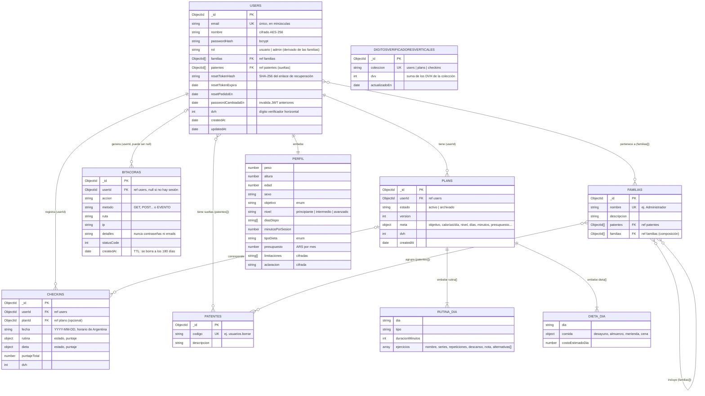

# DER lógico

FitPocket usa **MongoDB** (Atlas) a través de Mongoose. No es una base relacional: no hay tablas ni claves foráneas que el motor haga cumplir. Este diagrama usa la notación de entidad-relación para mostrar las **colecciones** y cómo se relacionan, con dos tipos de vínculo:

- **Referencia:** un documento guarda el `_id` (ObjectId) de otro, como una clave foránea. La integridad la mantiene la aplicación, por ejemplo: al borrar un usuario se borran sus planes y checkins.
- **Documento embebido:** los datos viven adentro del documento padre y no tienen colección propia (por ejemplo, el perfil dentro del usuario o la rutina dentro del plan). Se leen y escriben junto con el padre.

El diagrama refleja los modelos de `fullStack/backend/models/` a octubre de 2026.

## Cardinalidades

| Relación | Cardinalidad | Cómo se guarda | Qué pasa al borrar |
|---|---|---|---|
| Usuario → Planes | 1 a N (0 o más) | `plans.userId` | Se borran los planes del usuario |
| Usuario → Checkins | 1 a N (0 o más) | `checkins.userId` | Se borran los checkins del usuario |
| Plan → Checkins | 0..1 a N | `checkins.planId` (el plan activo al momento del checkin) | Los checkins quedan aunque el plan se archive |
| Usuario → Bitácora | 0..1 a N | `bitacoras.userId` (null en pedidos sin sesión) | Los registros quedan (son auditoría) hasta vencer por TTL |
| Usuario ↔ Familias | N a M | `users.familias[]` | — |
| Usuario ↔ Patentes sueltas | N a M | `users.patentes[]` | — |
| Familia ↔ Patentes | N a M | `familias.patentes[]` | — |
| Familia ↔ Familia | N a M (sin ciclos) | `familias.familias[]` | La aplicación rechaza una edición que formaría un ciclo |
| Usuario → Perfil | 1 a 1 | embebido en `users.perfil` | Se borra con el usuario |
| Plan → Días de rutina y de dieta | 1 a N | embebidos en `plans.rutina[]` y `plans.dieta[]` | Se borran con el plan |
| Colección → DVV | 1 a 1 | `digitosverificadoresverticales.coleccion` | — |

Un usuario tiene **como mucho un plan activo**: al generar uno nuevo, los anteriores pasan a `archivado`.

## Por qué referencias y por qué embebidos

- **El perfil, la rutina y la dieta van embebidos** porque siempre se leen junto con su documento padre (el dashboard pide el plan entero) y no tienen sentido solos. Leerlos es una sola consulta.
- **Planes y checkins son colecciones aparte** porque crecen sin límite (un checkin por día) y se consultan por rango de fechas. Embeberlos haría crecer el documento del usuario hasta el límite de 16 MB de MongoDB.
- **Patentes y familias son colecciones aparte** porque se comparten entre muchos usuarios: cambiar una familia afecta en el momento a todos los que la tienen.

## Índices

| Colección | Índice | Uso |
|---|---|---|
| `users` | `{ email: 1 }` único | Login y unicidad del email (RNF04) |
| `plans` | `{ userId: 1, estado: 1 }` | Buscar el plan activo de un usuario (lo hace casi cada pantalla) |
| `checkins` | `{ userId: 1, fecha: 1 }` único | Un checkin por usuario por día (RNF05) y la adherencia por rango de fechas |
| `bitacoras` | `{ createdAt: 1 }` con TTL de 180 días | Ordenar por fecha y borrar solos los registros viejos |
| `bitacoras` | `{ userId: 1, createdAt: -1 }` | Filtrar la bitácora por usuario |
| `patentes` | `{ codigo: 1 }` único | — |
| `familias` | `{ nombre: 1 }` único | — |
| `digitosverificadoresverticales` | `{ coleccion: 1 }` único | — |

El detalle de backup, particiones y dígitos verificadores está en [`estrategia-de-datos.md`](estrategia-de-datos.md).
