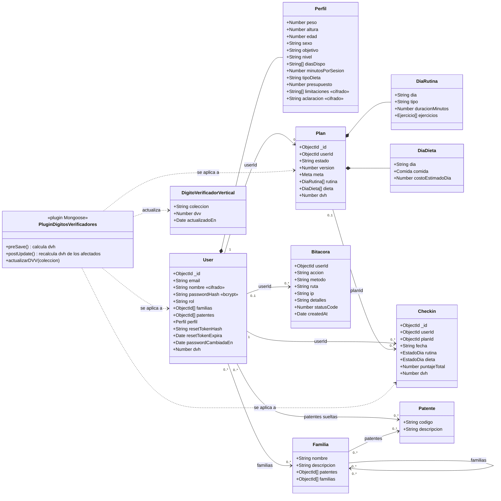
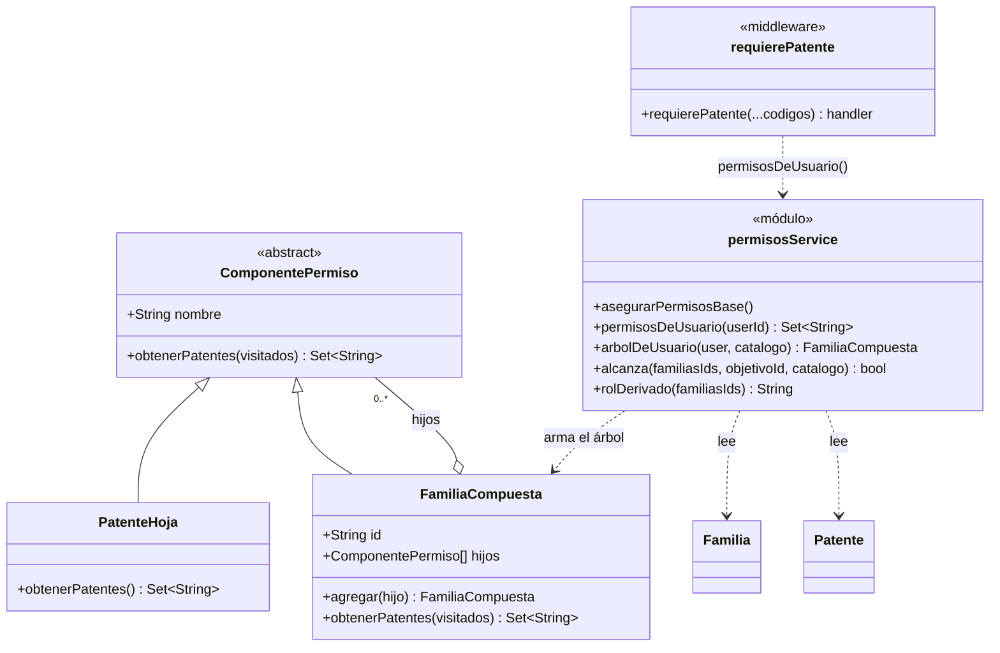
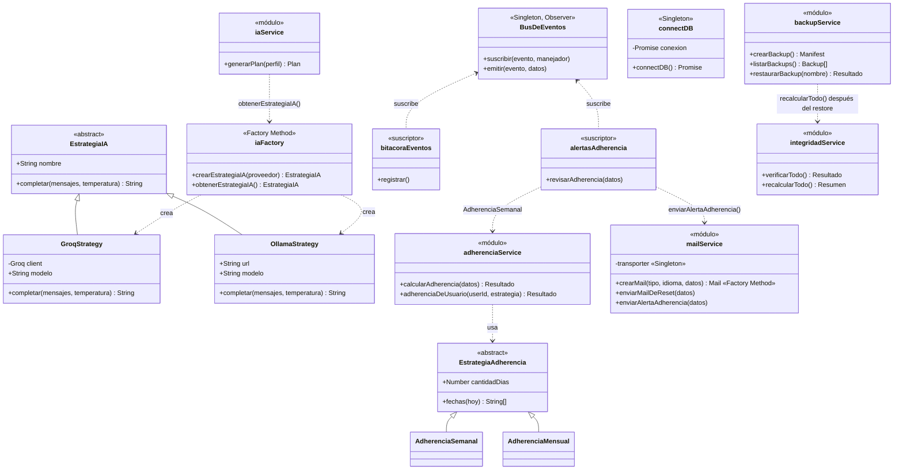

# Diagrama de clases

FitPocket está escrito en JavaScript, así que no todo es una `class`: los modelos son esquemas de Mongoose y muchos servicios son módulos con funciones. En el diagrama se representan igual, como clases con sus atributos y operaciones, para mostrar la estructura. Refleja el código de `fullStack/backend` a octubre de 2026.

Está dividido en tres partes para que se pueda leer: el modelo de datos, el control de acceso (Composite) y los servicios con los demás patrones.

## 1. Modelo de datos

## 2. Control de acceso (patrón Composite)

## 3. Servicios y patrones

Las relaciones entre controladores, rutas y servicios siguen la estructura MVC (RNF10): cada ruta valida el token (`auth`) y la patente (`requierePatente`), y llama a un controlador, que usa los modelos y los servicios. El detalle de cada patrón está en [`patrones-de-diseno.md`](patrones-de-diseno.md).
