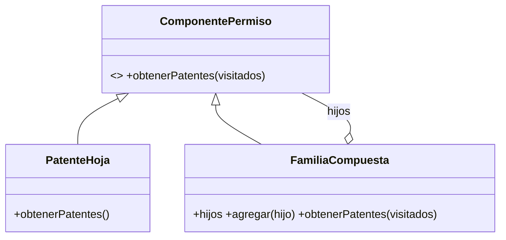
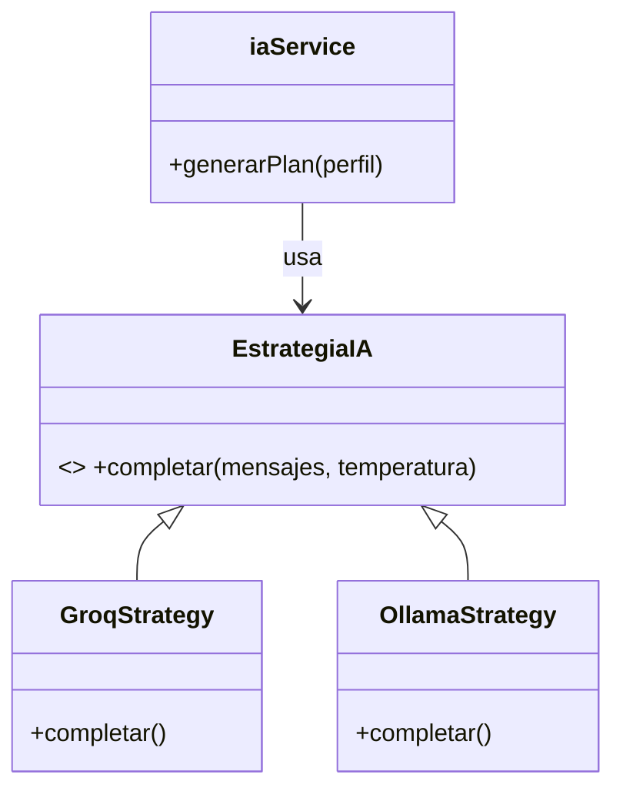
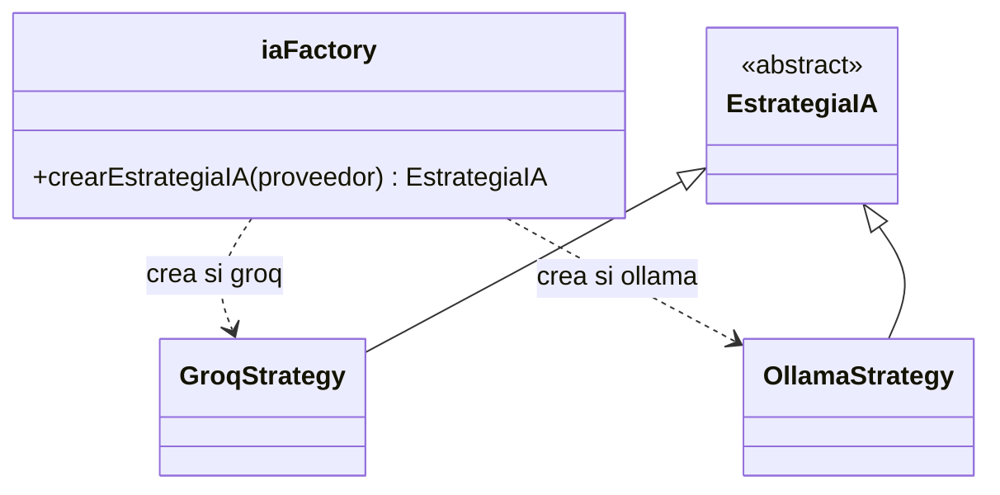
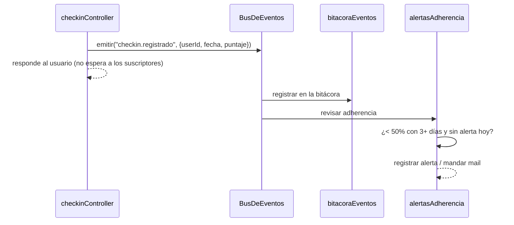

# Patrones de diseño

FitPocket usa cinco patrones de diseño. Cada uno resuelve un problema concreto del proyecto; ninguno se agregó solo para cumplir. En el código, cada uno está marcado con un comentario de una línea que dice qué patrón es (buscar "Patrón" en `fullStack/backend`).

| Patrón | Tipo | Dónde | Problema que resuelve |
|---|---|---|---|
| Composite | Estructural | `services/permisosService.js` | Familias de permisos que contienen otras familias |
| Strategy | Comportamiento | `services/ia/`, `services/adherenciaService.js` | Cambiar el proveedor de IA y el período de la adherencia |
| Factory Method | Creacional | `services/ia/iaFactory.js`, `services/mailService.js` | Crear la estrategia de IA y los mails según un parámetro |
| Observer | Comportamiento | `services/eventos.js`, `services/suscriptores/` | Reaccionar a eventos sin acoplar los controladores |
| Singleton | Creacional | `config/db.js`, transporter de `services/mailService.js`, bus de eventos | Un solo recurso compartido por proceso |

---

## Composite

**Problema.** La consigna pide permisos atómicos (patentes) agrupados en familias, y que una familia pueda contener otras: Administrador incluye todo lo de Usuario. Saber qué puede hacer alguien significa recorrer un árbol de profundidad variable, y la lógica no debería distinguir entre "una patente" y "una familia".

**Solución.** Patentes y familias implementan la misma interfaz `obtenerPatentes()`. Una patente (hoja) devuelve su código; una familia (compuesto) devuelve la unión de lo que devuelven sus hijos, sean patentes o familias. Los permisos de un usuario son una familia raíz con sus familias y sus patentes sueltas como hijos.

**Dónde.** `services/permisosService.js`: `ComponentePermiso`, `PatenteHoja`, `FamiliaCompuesta`, `arbolDeUsuario()`. Lo usa `middleware/requierePatente.js` en cada ruta protegida.

**Detalle importante: ciclos.** Si en la base quedara una familia que se contiene a sí misma (directa o indirectamente), el recorrido entraría en loop. `obtenerPatentes()` recibe un conjunto de familias ya visitadas y corta ahí. Además, la API rechaza una edición que formaría un ciclo y la pantalla no ofrece esas familias. Hay un test para cada caso.

**Por qué este patrón.** Agregar una familia nueva (por ejemplo "Auditor") o anidar una familia más no requiere tocar código: es un dato en la base.

---

## Strategy

### Proveedor de IA

**Problema.** `iaService` estaba atado a Groq: creaba el cliente al importarse (sin `GROQ_API_KEY` se caía todo el backend) y no había forma de usar otro modelo, por ejemplo uno local cuando se agota el límite gratuito.

**Solución.** Una interfaz `EstrategiaIA` con un solo método, `completar(mensajes, temperatura)`, y dos implementaciones: `GroqStrategy` (con el reintento ante el límite de tokens por minuto) y `OllamaStrategy` (HTTP a un servidor Ollama). `iaService` arma los prompts y procesa las respuestas sin saber qué proveedor hay atrás.

**Dónde.** `services/ia/EstrategiaIA.js`, `GroqStrategy.js`, `OllamaStrategy.js`; la usa `services/iaService.js`. En las pruebas se inyecta una estrategia falsa (`tests/helpers/iaFalsa.js`), así nunca se llama a Groq.

### Período de adherencia

**Problema.** La adherencia semanal (RF08) se calculaba dentro del controlador, mezclada con las consultas. La mensual requería duplicar todo cambiando un número.

**Solución.** `EstrategiaAdherencia` define qué fechas mira el cálculo; `AdherenciaSemanal` (7 días) y `AdherenciaMensual` (30) son las dos estrategias. El cálculo en sí (`calcularAdherencia`) es una función pura que se prueba sin base de datos.

**Dónde.** `services/adherenciaService.js`. Lo usan `GET /checkins/semana`, `GET /checkins/mes` y el suscriptor de alertas.

---

## Factory Method

**Problema.** Alguien tiene que decidir qué estrategia de IA crear, y validar la configuración. Si esa decisión estuviera en `iaService`, agregar un proveedor obligaría a tocarlo. Algo parecido pasa con los mails: cada tipo (recuperación, alerta) tiene textos en dos idiomas y un armado distinto.

**Solución.**

- `crearEstrategiaIA(proveedor)` crea la estrategia según la variable `IA_PROVIDER` a partir de una tabla `{ groq, ollama }`. Si el valor no existe, tira un error que lista los válidos, y `index.js` lo llama al arrancar: un `IA_PROVIDER=gpt` frena el backend con `IA_PROVIDER="gpt" no es válido. Usá uno de: groq, ollama.`
- `crearMail(tipo, idioma, datos)` arma asunto, texto plano y HTML del mail pedido, en el idioma del usuario (español si no se reconoce).

**Dónde.** `services/ia/iaFactory.js` y `services/mailService.js`.

**Por qué este patrón.** Sumar un proveedor nuevo (por ejemplo, la API de Claude u OpenAI) es escribir una clase nueva y agregar una línea a la tabla de la fábrica; nada más cambia.

---

## Observer

**Problema.** Cuando pasa algo importante (se registra un checkin, se genera un plan, se borra un usuario, se detecta una alteración) hay varias cosas que hacer: dejarlo en la bitácora, revisar si la adherencia bajó, mandar un mail. Si cada controlador hiciera todo eso, quedaría acoplado a la bitácora, al mail y a la lógica de alertas, y un error en el mail podría romper el checkin.

**Solución.** Un bus de eventos (`EventEmitter` de Node). Los controladores solo emiten "pasó X" con algunos datos; los suscriptores se registran una vez al iniciar la app y reaccionan.

| Evento | Lo emite | Suscriptores |
|---|---|---|
| `checkin.registrado` | `checkinController` | Bitácora; alertas de adherencia |
| `plan.generado` | `planController` | Bitácora |
| `usuario.borrado` | `userController` (baja propia o por admin) | Bitácora |
| `integridad.alterada` | `integridadController` | Bitácora |

El suscriptor de alertas calcula la adherencia semanal y, si baja del 50% con al menos 3 días contados, registra una alerta (y manda un mail si hay SMTP), como mucho una vez por día (RF10 parcial).

**Dónde.** `services/eventos.js` (el bus) y `services/suscriptores/` (`bitacoraEventos.js`, `alertasAdherencia.js`, `index.js`).

**Detalle importante.** Un suscriptor que falla registra el error pero no afecta la respuesta al usuario ni a los demás suscriptores (hay un test que lo comprueba).

---

## Singleton

**Problema.** Algunos recursos tienen que existir una sola vez por proceso: abrir dos conexiones a la base, o crear un transporter SMTP por cada mail, desperdicia conexiones; y si hubiera dos buses de eventos, los suscriptores de uno no oirían lo que se emite en el otro.

**Solución y dónde.**

- **Conexión a la base** (`config/db.js`): `connectDB()` guarda la promesa de la primera conexión y la devuelve en cada llamada siguiente, sin reconectar.
- **Transporter de mail** (`services/mailService.js`): se crea en el primer envío y se reutiliza (nodemailer mantiene la conexión).
- **Bus de eventos** (`services/eventos.js`): el módulo exporta una única instancia; Node guarda en caché los módulos, así que todos los que lo importan comparten la misma.
- **Estrategia de IA** (`iaFactory.obtenerEstrategiaIA()`): una por proceso, así Groq reutiliza su cliente HTTP.

**Por qué este patrón.** Es la forma más simple de garantizar un recurso único; en Node se apoya en la caché de módulos, sin necesidad de clases con constructor privado.
