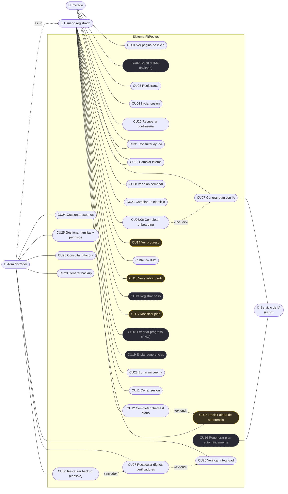

# Diagrama general de casos de uso

Reemplaza al diagrama original, que tenía el actor "Sistema N8N / IA". n8n ya no forma parte del proyecto: la lógica vive en el backend propio y la IA es un servicio externo (Groq).

Mermaid no tiene un tipo de diagrama de casos de uso, así que se dibuja con un diagrama de flujo: los actores van afuera del rectángulo del sistema y los casos de uso son las formas redondeadas de adentro. Los casos **en gris** todavía no están desarrollados; la tabla de abajo indica el estado de cada uno.

**Cómo leer las relaciones:**

- **Administrador "es un" Usuario registrado:** la familia Administrador incluye a la familia Usuario, así que el administrador también puede hacer todo lo del usuario.
- **«include»:** terminar el onboarding *siempre* dispara la generación del plan; restaurar un backup *siempre* termina con un recálculo de los dígitos verificadores.
- **«extend»:** recalcular es una extensión opcional de verificar (se hace después de revisar una alteración); la alerta de adherencia se dispara solo a veces al registrar un checkin (si la semana baja del 50% con 3 días o más).
- **CU15 Recibir alerta** apunta hacia el usuario porque lo inicia el sistema, no el usuario.

## Estado de cada caso

| Caso | Actor | Estado |
|---|---|---|
| CU01 Ver página de inicio | Invitado | Implementado |
| CU02 Calcular IMC (invitado) | Invitado | Pendiente |
| CU03 Registrarse | Invitado | Implementado |
| CU04 Iniciar sesión | Invitado | Implementado |
| CU05/06 Completar onboarding (4 pasos) | Usuario | Implementado |
| CU07 Generar plan con IA | Usuario, Servicio de IA | Implementado |
| CU08 Ver plan semanal | Usuario | Implementado |
| CU09 Ver IMC | Usuario | Implementado |
| CU10 Ver y editar perfil | Usuario | Parcial (el backend lo permite; falta la pantalla) |
| CU11 Cerrar sesión | Usuario | Implementado |
| CU12 Completar checklist diario | Usuario | Implementado |
| CU13 Registrar peso | Usuario | Pendiente |
| CU14 Ver progreso | Usuario | Parcial (adherencia sí; gráfico de peso no) |
| CU15 Recibir alerta de adherencia | Sistema → Usuario | Parcial (alerta registrada y mail con SMTP; falta push) |
| CU16 Regenerar plan automáticamente | Sistema, Servicio de IA | Pendiente |
| CU17 Modificar plan | Usuario | Parcial (reemplazo de ejercicios) |
| CU18 Exportar progreso (PNG) | Usuario | Pendiente |
| CU19 Enviar sugerencias | Usuario | Pendiente |
| CU20 Recuperar contraseña | Invitado | Implementado |
| CU21 Cambiar un ejercicio | Usuario | Implementado |
| CU22 Cambiar idioma | Todos | Implementado |
| CU23 Borrar mi cuenta | Usuario | Implementado |
| CU24 Gestionar usuarios | Administrador | Implementado |
| CU25 Gestionar familias y permisos | Administrador | Implementado |
| CU26 Verificar integridad | Administrador | Implementado |
| CU27 Recalcular dígitos verificadores | Administrador | Implementado |
| CU28 Consultar bitácora | Administrador | Implementado |
| CU29 Generar backup | Administrador | Implementado |
| CU30 Restaurar backup | Administrador (por consola) | Implementado |
| CU31 Consultar ayuda | Todos | Implementado |

Los casos del administrador en realidad dependen de **patentes**, no de un rol fijo: un usuario con la familia "Auditor" (`bitacora.ver` + `integridad.verificar`) puede hacer CU26 y CU28 sin ser administrador. El diagrama muestra la configuración por defecto.

La especificación completa de los casos principales está en [`especificaciones.md`](especificaciones.md).
