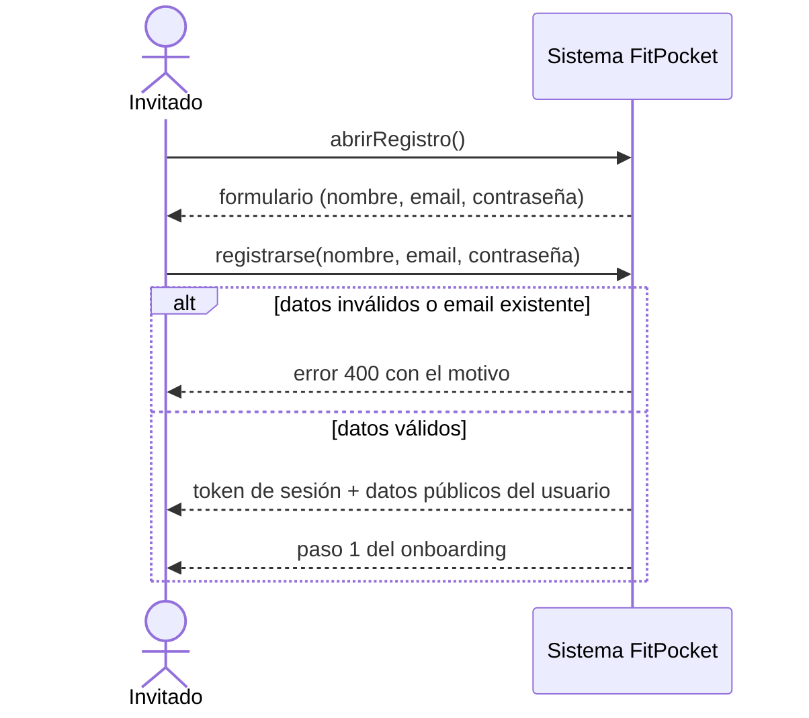
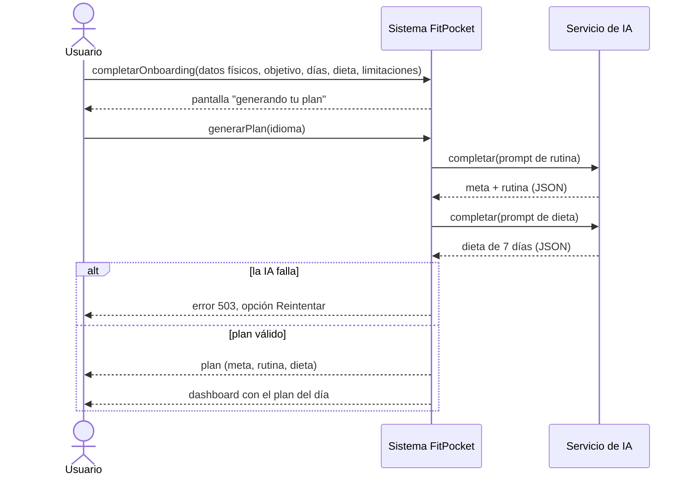
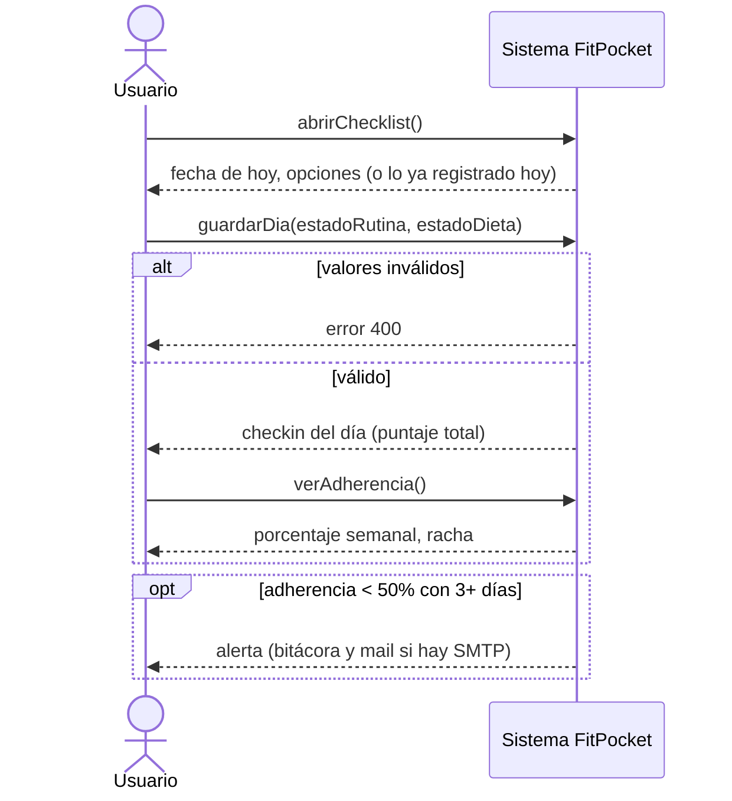
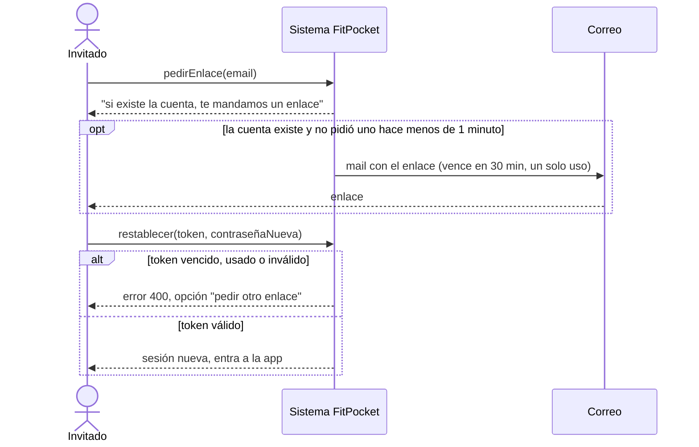
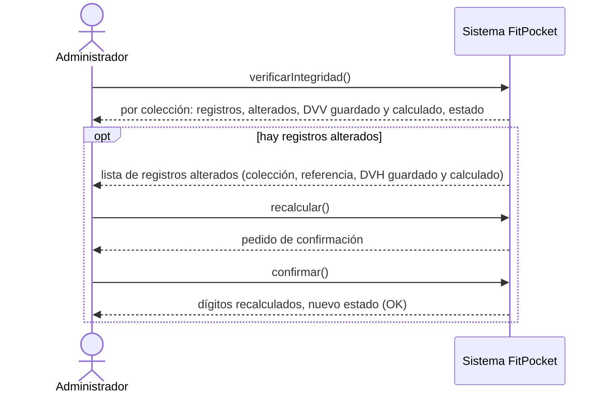
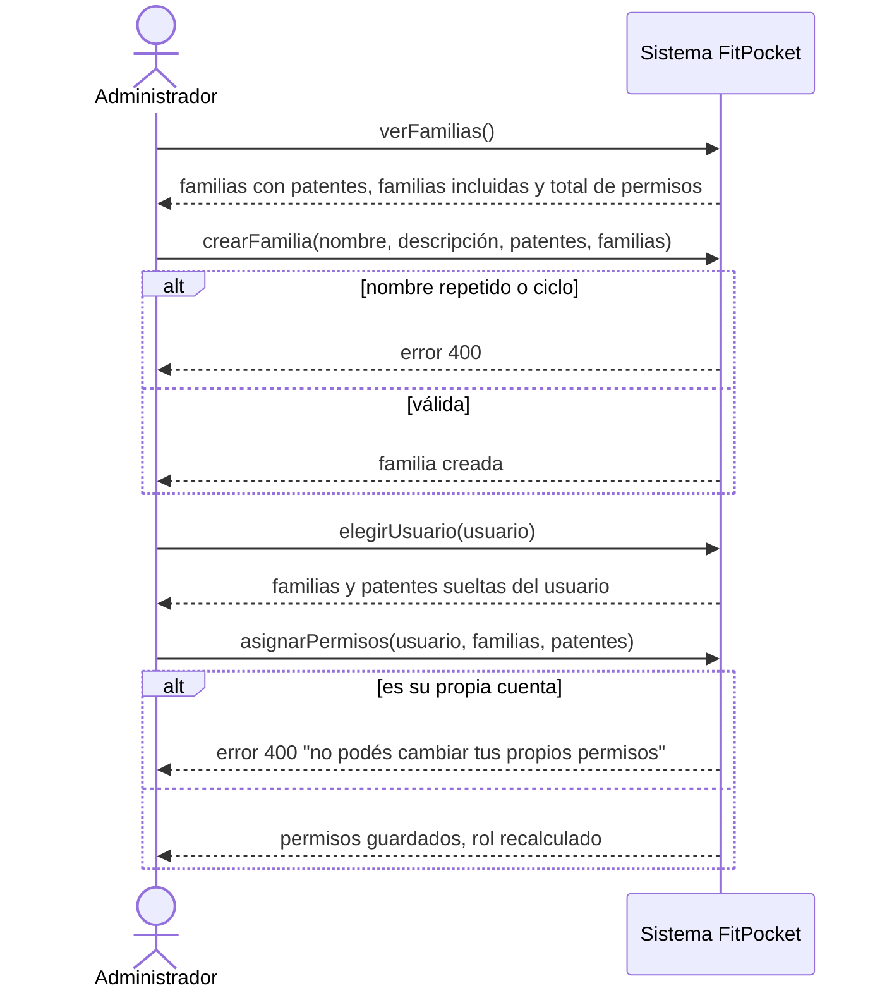

# Especificación de casos de uso

Seis casos de uso especificados en detalle: **Registrarse**, **Generar plan**, **Completar checklist diario**, **Recuperar contraseña**, **Verificar integridad** y **Gestionar familias**. Para cada uno: ficha, referencia a la interfaz, diagrama de secuencia del sistema (DSS) y clases que intervienen.

En los **DSS** el sistema es una caja negra: se muestran solo los mensajes que el actor le manda y lo que el sistema le devuelve, sin el detalle interno. Las clases que trabajan adentro están listadas en la última parte de cada caso.

Las capturas se guardan en [`../capturas/`](../capturas/) (ver el [manual de usuario](../manual-de-usuario.md)).

---

## CU03 · Registrarse

| | |
|---|---|
| **Actor** | Invitado |
| **Objetivo** | Crear una cuenta para poder generar un plan |
| **Precondición** | El invitado no tiene sesión iniciada |
| **Disparador** | Toca "Empezar gratis" en la página de inicio, o entra a `/register` |
| **Postcondición** | Existe la cuenta, con el nombre cifrado, la contraseña con hash bcrypt, la familia Usuario y el dígito verificador calculado. El usuario queda con sesión iniciada (JWT de 7 días) y está en el paso 1 del onboarding |

**Flujo normal**

1. El invitado abre el formulario de registro.
2. Ingresa nombre, email y contraseña. La pantalla muestra la fortaleza de la contraseña mientras la escribe.
3. Envía el formulario.
4. El sistema valida los datos (nombre no vacío, email con formato válido, contraseña de 8 caracteres o más) y que el email no esté registrado.
5. El sistema crea la cuenta: guarda el email en minúsculas, cifra el nombre (AES-256), guarda el hash bcrypt de la contraseña, le asigna la familia Usuario y calcula su DVH.
6. El sistema registra la acción en la bitácora (sin el email ni la contraseña) y devuelve un token de sesión.
7. La pantalla guarda la sesión y lleva al onboarding.

**Flujos alternativos**

- **2a. Ya tiene cuenta:** toca "Iniciá sesión" y pasa a CU04.

**Flujos de excepción**

- **4a. Falta un campo:** la pantalla muestra "Completá todos los campos para continuar." sin enviar nada.
- **4b. Email inválido o contraseña de menos de 8 caracteres:** el sistema responde 400 con el motivo; la pantalla lo muestra junto al formulario.
- **4c. El email ya existe** (sin importar mayúsculas ni espacios): el sistema responde 400 "El usuario ya existe".
- **5a. No hay conexión con el servidor:** la pantalla muestra un error de conexión y el invitado puede reintentar.

**Interfaz.** `/register` (`pages/Register`, formulario `components/componentsRegister/RegisterFormNew.jsx`). Captura: `capturas/02-registro.png`.

**DSS**

**Clases que intervienen**

| Capa | Clases / módulos |
|---|---|
| Frontend | `RegisterFormNew`, `apiCache.invalidarTodo()` |
| Backend | `authRoutes` → `authController.register`, `User` (con `PluginDigitosVerificadores`), `utils/crypto.encrypt`, `bcrypt`, `jsonwebtoken`, `permisosService.familiaBase('Usuario')`, middleware `bitacora` |

---

## CU07 · Generar plan

| | |
|---|---|
| **Actores** | Usuario registrado (principal), Servicio de IA (secundario) |
| **Objetivo** | Obtener una rutina y una dieta semanal personalizadas |
| **Precondición** | Sesión iniciada, patente `plan.generar`, onboarding completo (objetivo y días disponibles cargados) |
| **Disparador** | El usuario termina el paso 4 del onboarding («include» desde CU05/06) |
| **Postcondición** | Existe un plan activo nuevo con su DVH; el anterior, si había, quedó archivado. Se emite el evento `plan.generado` (queda en la bitácora) y se invalida la caché del plan en el navegador |

**Flujo normal**

1. El usuario confirma el último paso del onboarding.
2. El sistema guarda el perfil (limitaciones y aclaración cifradas) y muestra la pantalla de generación con los pasos animados.
3. El sistema le pide a la IA la rutina (con los días elegidos, el nivel, los minutos y las reglas de cada limitación) y después la dieta (con el tipo de dieta, las calorías objetivo y el presupuesto), en el idioma de la interfaz.
4. El sistema revisa la respuesta: conserva solo los días elegidos, reemplaza por una alternativa permitida (o quita) los ejercicios contraindicados y fija el nivel y el presupuesto que cargó el usuario.
5. El sistema archiva el plan activo anterior y guarda el nuevo.
6. La pantalla muestra "listo" y lleva al dashboard con el plan del día.

**Flujos alternativos**

- **3a. La IA devuelve un JSON mal formado:** el sistema se lo vuelve a pedir una vez, aclarando que responda solo con JSON.
- **3b. La rutina no cubre todos los días elegidos:** el sistema la pide una vez más y se queda con la que cubra más días.
- **3c. Groq responde que se alcanzó el límite de tokens por minuto:** el sistema espera lo que indica Groq y reintenta, hasta 90 segundos en total.

**Flujos de excepción**

- **1a. No completó el onboarding:** 400 "Falta completar el perfil antes de generar un plan".
- **3d. La IA no responde o falla:** 503 "El servicio de IA no está disponible"; no se guarda nada y el plan anterior sigue activo. La pantalla ofrece **Reintentar**.
- **4a. Después del filtro no queda ningún día con ejercicios:** 503 y no se guarda el plan.
- **1b. La sesión venció:** la pantalla avisa y lleva a iniciar sesión.

**Interfaz.** `/onboarding/4` → `/cargando-plan` → `/dashboard` (`pages/CargandoPlan`). Capturas: `capturas/04-onboarding-4.png`, `capturas/05-generando-plan.png`.

**DSS**

**Clases que intervienen**

| Capa | Clases / módulos |
|---|---|
| Frontend | `OnboardingForm4`, `CargandoPlan`, `apiCache.invalidar('plan', 'semana', 'hoy')` |
| Backend | `planRoutes` → `requierePatente('plan.generar')` → `planController.generarPlan`, `iaService.generarPlan`, `iaFactory` → `GroqStrategy` (o `OllamaStrategy`), `filtrarContraindicados`, `Plan` (+ plugin DVH), `BusDeEventos` (`plan.generado`) → `bitacoraEventos` |

---

## CU12 · Completar checklist diario

| | |
|---|---|
| **Actor** | Usuario registrado |
| **Objetivo** | Registrar cómo le fue hoy con la rutina y con la dieta |
| **Precondición** | Sesión iniciada, patente `checkin.registrar`, plan activo |
| **Disparador** | Abre la pestaña Checklist del dashboard |
| **Postcondición** | Existe un checkin para el usuario y la fecha de hoy (horario de Argentina) con su DVH. La adherencia y la racha están actualizadas. Se emitió `checkin.registrado` |

**Flujo normal**

1. El usuario abre la pestaña Checklist.
2. El sistema muestra la fecha de hoy y, para la rutina y para la dieta, las opciones Completado, Parcial y No hice.
3. El usuario elige una opción para cada uno y toca **Guardar día**.
4. El sistema valida los valores, calcula el puntaje (1, 0,5 o 0 cada uno) y guarda el checkin del día asociado al plan activo.
5. La pantalla muestra el día como registrado y actualiza la adherencia semanal y la racha.
6. En segundo plano, el sistema revisa la adherencia de la semana (CU15).

**Flujos alternativos**

- **1a. Ya registró hoy:** la pantalla muestra lo registrado, sin poder cambiarlo hasta el día siguiente.
- **6a. La adherencia semanal bajó del 50% con 3 días o más contados y todavía no hubo alerta hoy:** el sistema registra una alerta en la bitácora y, si hay SMTP, le manda un mail (CU15, «extend»).

**Flujos de excepción**

- **3a. Falta elegir una de las dos opciones:** el botón Guardar día está deshabilitado.
- **4a. Valores inválidos (por ejemplo, manipulando el pedido):** 400 "Estado inválido".
- **4b. Error de conexión:** la pantalla muestra el error y el usuario puede volver a guardar.

**Interfaz.** `/dashboard` → pestaña Checklist (`pages/Dashboard/ChecklistTab.jsx`). Captura: `capturas/08-checklist.png`.

**DSS**

**Clases que intervienen**

| Capa | Clases / módulos |
|---|---|
| Frontend | `Dashboard`, `ChecklistTab`, `AyudaTip`, `apiCache` (`actualizarCache('hoy')`, `invalidar('semana')`) |
| Backend | `checkinRoutes` → `requierePatente('checkin.registrar')` → `checkinController.registrarCheckin`, `Checkin` (+ plugin DVH), `utils/fecha.fechaLocal`, `BusDeEventos` (`checkin.registrado`) → `bitacoraEventos`, `alertasAdherencia` → `adherenciaService` (`AdherenciaSemanal`), `mailService` |

---

## CU20 · Recuperar contraseña

| | |
|---|---|
| **Actor** | Invitado (usuario que olvidó su contraseña) |
| **Objetivo** | Volver a entrar eligiendo una contraseña nueva |
| **Precondición** | Tiene una cuenta y acceso al mail con el que se registró |
| **Disparador** | Toca "¿Olvidaste tu contraseña?" en el inicio de sesión |
| **Postcondición** | La contraseña cambió (nuevo hash bcrypt), el enlace quedó inutilizado, las sesiones anteriores dejaron de valer y el usuario tiene una sesión nueva |

**Flujo normal**

1. El usuario toca "¿Olvidaste tu contraseña?" e ingresa su email.
2. El sistema responde siempre lo mismo ("Si ese email tiene una cuenta, te enviamos un enlace"), exista o no la cuenta.
3. Si la cuenta existe, el sistema genera un token aleatorio, guarda **solo su hash SHA-256** con un vencimiento de 30 minutos y manda el enlace por mail (o lo imprime en la consola del backend si no hay SMTP).
4. El usuario abre el enlace y elige una contraseña nueva (dos veces).
5. El sistema valida el token y su vencimiento, guarda el hash de la contraseña nueva, borra el token y marca la fecha del cambio.
6. El sistema devuelve una sesión nueva y el usuario entra directo a la app.

**Flujos alternativos**

- **3a. Ya pidió un enlace hace menos de un minuto:** el sistema no manda otro (la respuesta es la misma, para no revelar nada).

**Flujos de excepción**

- **1a. Email con formato inválido:** 400 "El email no es válido".
- **4a. Las dos contraseñas no coinciden o tienen menos de 8 caracteres:** la pantalla lo indica antes de enviar.
- **5a. El enlace venció, ya se usó o está incompleto:** 400 "El enlace no es válido o ya venció"; la pantalla ofrece pedir uno nuevo.

**Interfaz.** `/recuperar` (`pages/Recuperar/Recuperar.jsx`) y `/restablecer?token=...` (`pages/Recuperar/Restablecer.jsx`). Capturas: `capturas/14-recuperar.png`, `capturas/15-restablecer.png`.

**DSS**

**Clases que intervienen**

| Capa | Clases / módulos |
|---|---|
| Frontend | `AuthModal`, `Recuperar`, `Restablecer`, `apiCache.invalidarTodo()` |
| Backend | `authRoutes` → `authController.forgotPassword` / `resetPassword`, `User`, `crypto` de Node (token aleatorio y SHA-256), `bcrypt`, `mailService.crearMail('recuperacion')` (Factory Method) con el transporter Singleton, middleware `auth` (rechaza los JWT anteriores a `passwordCambiadaEn`) |

---

## CU26 · Verificar integridad

| | |
|---|---|
| **Actor** | Administrador (o cualquier usuario con la patente `integridad.verificar`) |
| **Objetivo** | Saber si alguien modificó, agregó o borró datos por fuera de la app |
| **Precondición** | Sesión iniciada con la patente `integridad.verificar` |
| **Disparador** | Toca **Verificar** en la pestaña Integridad del panel |
| **Postcondición** | El administrador ve el estado de cada colección. Si hubo alteraciones, se emitió `integridad.alterada` y quedó en la bitácora. No se modifica ningún dato |

**Flujo normal**

1. El administrador abre `/admin` → pestaña Integridad.
2. Toca **Verificar**.
3. El sistema recalcula el DVH de cada usuario, plan y checkin y lo compara con el guardado; suma los DVH calculados de cada colección y lo compara con el DVV guardado.
4. La pantalla muestra un resumen ("Todo en orden" o "Se encontraron N registros alterados"), una tabla por colección (registros, alterados, DVV guardado, DVV calculado, estado) y la lista de registros alterados con su identificación.

**Flujos alternativos**

- **4a. Hay alteraciones y el administrador ya revisó qué pasó (en la bitácora):** toca **Recalcular**, confirma en el diálogo y el sistema recalcula todos los dígitos (CU27, «extend»). La pantalla vuelve a verificar y muestra el estado nuevo.

**Flujos de excepción**

- **1a. Sin la patente:** la pestaña no aparece; si se llama a la API igual, responde 403.
- **3a. Error de conexión:** la pantalla muestra el error con un botón Reintentar.

**Interfaz.** `/admin?tab=integridad` (`pages/Admin/IntegridadTab.jsx`). Capturas: `capturas/19-admin-integridad.png`.

**DSS**

**Clases que intervienen**

| Capa | Clases / módulos |
|---|---|
| Frontend | `Admin`, `IntegridadTab`, `DialogoConfirmacion`, `usePermisos` / `ConPermiso` |
| Backend | `integridadRoutes` → `requierePatente('integridad.verificar' / 'integridad.recalcular')` → `integridadController`, `integridadService` (`verificarTodo`, `recalcularTodo`), `utils/digitosVerificadores` (`camposDVH`, `dvhDe`, `calcularDVV`), `User`, `Plan`, `Checkin`, `DigitoVerificadorVertical`, `BusDeEventos` (`integridad.alterada`) |

---

## CU25 · Gestionar familias

| | |
|---|---|
| **Actor** | Administrador (patente `familias.gestionar`) |
| **Objetivo** | Definir grupos de permisos y decidir qué puede hacer cada usuario |
| **Precondición** | Sesión iniciada con la patente `familias.gestionar` |
| **Disparador** | Abre la pestaña Familias y permisos del panel |
| **Postcondición** | Las familias y las asignaciones quedaron guardadas. Los permisos de los usuarios afectados cambian en el momento (el siguiente pedido ya los usa), y el `rol` de cada uno se recalcula a partir de sus familias |

**Flujo normal (crear una familia y asignarla)**

1. El administrador abre la pestaña Familias y permisos. El sistema muestra cada familia con sus patentes, las familias que incluye y el total de permisos efectivos.
2. Toca **Nueva familia**, escribe el nombre y la descripción, marca las patentes y, opcionalmente, las familias que incluye. Toca **Guardar familia**.
3. El sistema valida que el nombre no exista, que las patentes y familias existan y que no se forme un ciclo, y guarda la familia.
4. En **Permisos de un usuario**, el administrador elige un usuario. El sistema muestra sus familias y patentes sueltas.
5. Marca o desmarca familias y patentes. La pantalla muestra en vivo cuántos y cuáles permisos va a tener.
6. Toca **Guardar permisos**. El sistema guarda la asignación, recalcula el rol del usuario y lo confirma.

**Flujos alternativos**

- **2a. Editar una familia existente:** toca **Editar** en la tarjeta. Las familias base (Usuario y Administrador) se pueden editar pero no renombrar.
- **2b. Familias que formarían un ciclo:** no se ofrecen al editar (por ejemplo, Administrador al editar Usuario, porque Administrador ya incluye a Usuario).

**Flujos de excepción**

- **3a. Nombre repetido, vacío o una familia que se contendría a sí misma (por ejemplo, armando el pedido a mano):** 400 con el motivo; la pantalla muestra "No se pudo guardar".
- **4a. Elige su propia cuenta:** la pantalla avisa que no puede cambiar sus propios permisos (el sistema también lo rechaza con 400), para que un administrador no se quite el acceso por error.
- **6a. Le quita a alguien todos los permisos:** la pantalla avisa "Sin permisos no va a poder usar la app" antes de guardar.

**Interfaz.** `/admin?tab=familias` (`pages/Admin/FamiliasTab.jsx`). Capturas: `capturas/18-admin-familias.png`.

**DSS**

**Clases que intervienen**

| Capa | Clases / módulos |
|---|---|
| Frontend | `Admin`, `FamiliasTab` (`EditorFamilia`, `ListaPatentes`, `patentesEfectivas`, `alcanza`), `usePermisos` |
| Backend | `permisosRoutes` → `requierePatente('familias.gestionar')` → `permisosController` (`crearFamilia`, `editarFamilia`, `asignarAUsuario`), `permisosService` (`FamiliaCompuesta`, `PatenteHoja`, `alcanza`, `rolDerivado`), `Familia`, `Patente`, `User` (+ plugin DVH, porque el rol entra en el DVH) |
