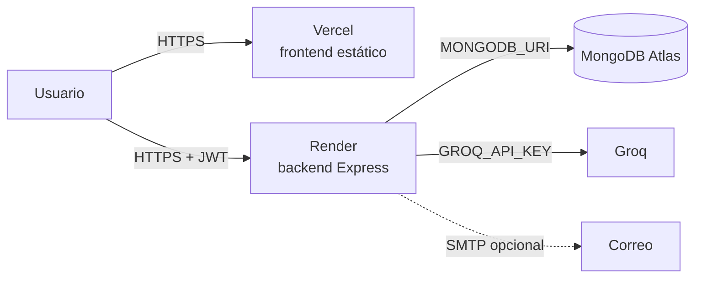

# Despliegue de FitPocket

Guía paso a paso para publicar FitPocket con servicios gratuitos:

| Pieza | Servicio | Qué corre ahí |
|---|---|---|
| Base de datos | MongoDB Atlas (M0, gratis) | Las colecciones de la app |
| Backend | Render (Web Service, plan Free) | `fullStack/backend` (Node + Express) |
| Frontend | Vercel (plan Hobby) | `fullStack/frontend` (sitio estático de Vite) |
| IA | Groq | Generación de planes (`GROQ_API_KEY`) |

Railway (en lugar de Render) y Netlify (en lugar de Vercel) funcionan igual: al final hay notas para esas alternativas.



El frontend es solo archivos estáticos: el navegador del usuario habla directo con el backend de Render. Por eso el backend tiene que aceptar pedidos desde la URL de Vercel (CORS, variable `FRONTEND_URL`) y el frontend tiene que saber la URL de Render (variable `VITE_API_URL`).

---

## 0. Antes de empezar: dos decisiones

### a) ¿Base nueva o los datos actuales?

- **Base nueva (recomendado).** Producción arranca vacía, en una base aparte del mismo cluster de Atlas (por ejemplo `fitpocket-prod`). Los datos de prueba de desarrollo no se mezclan con los reales y se puede usar una `CRYPTO_KEY` nueva desde el primer día.
- **Llevar los datos actuales.** Hay que re-cifrarlos con la clave nueva (paso 0.b), porque la clave con la que están cifrados hoy está publicada en el repositorio.

### b) La `CRYPTO_KEY`

El nombre, las limitaciones físicas y la aclaración de cada usuario se guardan cifrados con `CRYPTO_KEY`. Hasta esta versión, si la variable faltaba, el código usaba una clave por defecto escrita en `utils/crypto.js`. **Esa clave está en el historial de git, así que no protege nada en producción.** Ahora:

- **En desarrollo**, la variable es obligatoria. Para seguir leyendo los datos que ya existen, cada integrante agrega a su `fullStack/backend/.env` la clave que se usaba por defecto:
  ```
  CRYPTO_KEY=fitpocket_default_key_cambiar
  ```
- **En producción**, el backend no arranca con esa clave: hay que generar una nueva y secreta (ver paso 2). Si se llevan los datos actuales, se pasan a la clave nueva con:
  ```bash
  cd fullStack/backend
  node scripts/backup.js                                   # primero, un backup
  # en el .env: MONGODB_URI de la base a migrar y CRYPTO_KEY=<la nueva>
  CRYPTO_KEY_ANTERIOR=fitpocket_default_key_cambiar node scripts/recifrar.js --simular   # cuenta, no cambia nada
  CRYPTO_KEY_ANTERIOR=fitpocket_default_key_cambiar node scripts/recifrar.js             # pide confirmación
  ```
  El script se puede correr más de una vez (lo ya migrado no se toca). Las cuentas que no abren con ninguna de las dos claves se informan y se dejan como están: en la base de desarrollo actual hay 2, creadas en otra máquina con otra `CRYPTO_KEY`.

---

## 1. MongoDB Atlas

1. Entrar a [cloud.mongodb.com](https://cloud.mongodb.com) con la cuenta del proyecto.
2. **Usuario de base de datos.** *Database Access → Add New Database User*: usuario `fitpocket-prod`, contraseña generada (guardarla), rol *Read and write to any database*. Conviene que no sea el mismo usuario que se usa en desarrollo.
3. **Acceso de red.** *Network Access → Add IP Address → Allow access from anywhere* (`0.0.0.0/0`).
   Render (plan gratis) no tiene una IP fija, así que no se puede limitar por IP. La protección queda en el usuario y la contraseña de la base: que sean largos y que no se compartan.
4. **Cadena de conexión.** *Database → Connect → Drivers*. Copiar la URI y completar usuario, contraseña y el nombre de la base:
   ```
   mongodb+srv://fitpocket-prod:<contraseña>@cluster0.xxxxx.mongodb.net/fitpocket-prod?retryWrites=true&w=majority
   ```
   El nombre después de la `/` es la base. Si no existe, Atlas la crea con la primera escritura.

---

## 2. Backend en Render

### 2.1 Generar las claves

En cualquier terminal con Node, correr dos veces (una para cada clave) y guardar los resultados:

```bash
node -e "console.log(require('crypto').randomBytes(48).toString('base64url'))"
```

`JWT_SECRET` y `CRYPTO_KEY` tienen que ser distintas, de 32 caracteres o más. **Si se pierde la `CRYPTO_KEY`, los nombres y datos de salud guardados no se pueden recuperar**: guardarla en un gestor de contraseñas del equipo.

### 2.2 Crear el servicio

1. Entrar a [render.com](https://render.com) con GitHub y autorizar el repositorio `FitPocket`.
2. *New → Web Service* → elegir el repositorio.
3. Completar:

   | Campo | Valor |
   |---|---|
   | Name | `fitpocket-api` (queda la URL `https://fitpocket-api.onrender.com`) |
   | Branch | `main` (o la rama que se quiera publicar) |
   | Root Directory | `fullStack/backend` |
   | Runtime | Node |
   | Build Command | `npm ci --omit=dev` |
   | Start Command | `node index.js` |
   | Instance Type | Free |

4. En *Advanced → Health Check Path* poner `/salud`. Render lo usa para saber si el servicio está vivo; esa ruta no toca la base ni llena la bitácora.

### 2.3 Variables de entorno (*Environment*)

| Variable | Valor | Obligatoria |
|---|---|---|
| `NODE_ENV` | `production` | Sí |
| `NODE_VERSION` | `22` | Recomendada (la versión que usan las pruebas) |
| `MONGODB_URI` | la URI del paso 1.4 | Sí |
| `JWT_SECRET` | la primera clave del paso 2.1 | Sí |
| `CRYPTO_KEY` | la segunda clave del paso 2.1 | Sí |
| `FRONTEND_URL` | la URL de Vercel (se completa en el paso 4; mientras tanto, cualquier valor) | Sí |
| `GROQ_API_KEY` | la clave de [console.groq.com](https://console.groq.com/keys) | Para generar planes |
| `IA_PROVIDER` | `groq` | No (es el valor por defecto) |
| `SMTP_HOST`, `SMTP_PORT`, `SMTP_USER`, `SMTP_PASS`, `MAIL_FROM` | ver paso 6 | No (sin SMTP el enlace de recuperación sale en los logs) |
| `BITACORA_TTL_DIAS` | `180` | No |

`PORT` no se configura: Render la define sola y el backend la respeta.

Con `NODE_ENV=production` el backend **no arranca** si falta alguna variable obligatoria, si una clave tiene menos de 32 caracteres, si `JWT_SECRET` y `CRYPTO_KEY` son iguales o si se usa un valor de ejemplo. El motivo aparece en los logs de Render (*Logs*), por ejemplo:

```
No se puede iniciar el backend. Revisá el .env (o las variables de la plataforma):
  - JWT_SECRET tiene que tener al menos 32 caracteres en producción.
```

### 2.4 Primer despliegue

*Create Web Service*. Cuando termine, abrir `https://fitpocket-api.onrender.com/salud`: tiene que responder `{"ok":true}`.

---

## 3. Permisos y primer administrador

La base nueva arranca sin patentes ni familias. Se cargan desde una computadora del equipo, apuntando a la base de producción:

1. En `fullStack/backend/.env`, cambiar **temporalmente** `MONGODB_URI` por la de producción y `CRYPTO_KEY` por la de producción.
2. Correr:
   ```bash
   cd fullStack/backend
   node scripts/seedPermisos.js            # crea las 12 patentes y las familias Usuario y Administrador
   node scripts/recalcularDigitos.js       # deja los dígitos verificadores al día
   ```
3. Registrarse desde la app publicada (paso 4) con la cuenta que va a ser administradora, y después:
   ```bash
   node scripts/crearAdmin.js email-del-admin@ejemplo.com
   ```
4. **Volver a dejar el `.env` como estaba** (base y clave de desarrollo), para no tocar producción por error.

---

## 4. Frontend en Vercel

1. Entrar a [vercel.com](https://vercel.com) con GitHub → *Add New → Project* → importar `FitPocket`.
2. Completar:

   | Campo | Valor |
   |---|---|
   | Root Directory | `fullStack/frontend` |
   | Framework Preset | Vite (lo detecta solo) |
   | Build Command | `npm run build` |
   | Output Directory | `dist` |

3. *Environment Variables*: `VITE_API_URL` = `https://fitpocket-api.onrender.com` (sin `/` al final).
   Vite incrusta este valor al compilar: si la URL del backend cambia, hay que volver a desplegar el front.
4. *Deploy*. Queda una URL como `https://fitpocket.vercel.app`.

`fullStack/frontend/vercel.json` ya está en el repositorio y hace dos cosas:

- **Redirige todas las rutas a `index.html`.** Sin esto, entrar directo a `https://fitpocket.vercel.app/dashboard` (o recargar en cualquier pantalla que no sea el inicio) daría 404, porque esas rutas las resuelve React Router en el navegador.
- Marca los archivos de `/assets/` como inmutables (llevan el hash en el nombre), así el navegador no los vuelve a pedir.

### 4.1 Conectar el backend con el front

Volver a Render → *Environment* → `FRONTEND_URL` = la URL de Vercel (por ejemplo `https://fitpocket.vercel.app`) → guardar. Render redespliega solo.

Con eso:

- **CORS** acepta pedidos solo desde esa URL. Si en la consola del navegador aparece *"blocked by CORS policy"*, casi siempre es que `FRONTEND_URL` no coincide exactamente con la URL del front (`https`, sin `/` al final). Se pueden poner varias separadas por coma, por ejemplo el dominio de producción y el de previsualización de Vercel.
- Los **mails de recuperación** apuntan a esa URL.

---

## 5. Verificación después de desplegar

| # | Qué probar | Resultado esperado |
|---|---|---|
| 1 | Abrir `https://fitpocket-api.onrender.com/salud` | `{"ok":true}` |
| 2 | Abrir la URL de Vercel y recargar con F5 en `/ayuda` | La página carga (no 404) |
| 3 | Registrarse, completar el onboarding y generar el plan | Se genera el plan (si falla, revisar `GROQ_API_KEY` en los logs) |
| 4 | Recargar `/dashboard` y `/plan` | Siguen funcionando |
| 5 | "¿Olvidaste tu contraseña?" | Llega el mail, o el enlace aparece en los logs de Render si no hay SMTP |
| 6 | Entrar con el admin → `/admin` → Integridad → Verificar | Todo OK |
| 7 | En Atlas, abrir un usuario en la colección `users` | `nombre` se ve cifrado (`3f9a...:c1b2...`) y no hay contraseñas en texto plano |

Después conviene correr el [plan de pruebas manuales](pruebas/casos-de-prueba-manuales.md) completo sobre la versión publicada.

---

## 6. Correo (opcional)

Sin SMTP la app funciona igual: el enlace de recuperación de contraseña se imprime en los logs del backend. Para mandar mails de verdad con una cuenta de Gmail:

1. En la cuenta de Google: activar la verificación en dos pasos y crear una *contraseña de aplicación* (Cuenta de Google → Seguridad → Contraseñas de aplicaciones).
2. En Render:

   | Variable | Valor |
   |---|---|
   | `SMTP_HOST` | `smtp.gmail.com` |
   | `SMTP_PORT` | `465` |
   | `SMTP_USER` | la dirección de Gmail |
   | `SMTP_PASS` | la contraseña de aplicación (16 caracteres, sin espacios) |
   | `MAIL_FROM` | `FitPocket <la-direccion@gmail.com>` |

Con SMTP configurado también se mandan las alertas de adherencia baja (como mucho una por día por usuario).

---

## 7. Backups en producción

El botón **Backup** de `/admin` guarda los archivos **en el disco del servidor**. En el plan gratis de Render ese disco se borra en cada despliegue y cada vez que el servicio se duerme, así que **esos backups no sirven en Render Free**.

Estrategia recomendada para producción:

- **Frecuencia:** un backup por semana, y siempre antes de un despliegue que cambie modelos o de correr `recifrar.js`.
- **Cómo:** desde una computadora del equipo, con la `MONGODB_URI` y la `CRYPTO_KEY` de producción en el `.env` (como en el paso 3):
  ```bash
  cd fullStack/backend
  node scripts/backup.js
  ```
  Queda en `fullStack/backend/backups/backup_FECHA/`, carpeta que no se sube a git porque tiene datos de usuarios.
- **Retención:** se conservan los últimos 7 (`BACKUP_RETENCION`). Copiar el más reciente a un lugar seguro fuera de esa computadora (por ejemplo el Drive del equipo).
- **Restore:** `node scripts/restore.js backup_FECHA`. Pide confirmación y recalcula los dígitos verificadores al terminar.
- Para que el botón de `/admin` guarde backups permanentes hace falta un disco persistente (*Render → Disks*, plan pago) con `BACKUP_DIR` apuntando a ese disco.

Atlas M0 no incluye backups automáticos; los clusters pagos sí (*Cloud Backup*).

---

## 8. Limitaciones del plan gratis

- **Render Free se duerme** después de 15 minutos sin pedidos. El primer pedido después de eso tarda entre 30 y 60 segundos en responder. Para una demo, abrir `/salud` un minuto antes.
- **Groq gratis** permite 8000 tokens por minuto y un plan usa cerca de 4000: con dos o tres personas generando planes a la vez, el backend espera y reintenta (puede tardar hasta un minuto y medio).
- **Atlas M0**: 512 MB de almacenamiento, sin sharding ni backups automáticos. La bitácora se recorta sola a los últimos `BITACORA_TTL_DIAS` días para no llenar ese espacio.

---

## 9. Alternativas

- **Railway en lugar de Render.** *New Project → Deploy from GitHub repo*, *Settings → Root Directory* `fullStack/backend`, mismas variables de entorno. Railway también define `PORT` solo.
- **Netlify en lugar de Vercel.** Base directory `fullStack/frontend`, build `npm run build`, publish `dist`, variable `VITE_API_URL`. En lugar de `vercel.json`, crear `fullStack/frontend/public/_redirects` con la línea `/* /index.html 200`.
- **Docker.** `fullStack/backend/Dockerfile` arma una imagen de producción (Node 22, sin dependencias de desarrollo, usuario sin privilegios):
  ```bash
  cd fullStack/backend
  docker build -t fitpocket-api .
  docker run -p 3000:3000 --env-file .env fitpocket-api
  ```

---

## 10. Problemas frecuentes

| Síntoma | Causa probable | Qué hacer |
|---|---|---|
| Render: *"No se puede iniciar el backend"* | Falta una variable o una clave es corta | Leer la lista en los logs y corregir las variables |
| Render: *"Could not connect to any servers"* | Atlas no acepta la conexión | Revisar *Network Access* (`0.0.0.0/0`) y el usuario y la contraseña de la URI |
| Navegador: *"blocked by CORS policy"* | `FRONTEND_URL` no coincide con la URL del front | Copiar la URL exacta de Vercel, con `https://` y sin `/` al final |
| 404 al recargar `/dashboard` en Vercel | Falta `vercel.json` o el Root Directory no es `fullStack/frontend` | Revisar la configuración del proyecto en Vercel |
| El front llama a `localhost:3000` | `VITE_API_URL` no estaba al compilar | Configurar la variable en Vercel y volver a desplegar |
| "Nombre no disponible" en `/admin` | La cuenta se cifró con otra `CRYPTO_KEY` | Usar la misma `CRYPTO_KEY` en todos los entornos que comparten la base, o re-cifrar con `recifrar.js` |
| Generar el plan devuelve 503 | Falta `GROQ_API_KEY` o Groq está saturado | Revisar la variable y los logs; reintentar en un minuto |
