# Manual de usuario de FitPocket

FitPocket arma un plan de entrenamiento y alimentación a tu medida, y te ayuda a seguirlo día a día. Este manual explica cómo usarlo, paso a paso.

- [Si todavía no tenés cuenta](#1-si-todavía-no-tenés-cuenta)
- [Si ya tenés cuenta](#2-si-ya-tenés-cuenta)
- [Si sos administrador](#3-si-sos-administrador)
- [Preguntas frecuentes](#4-preguntas-frecuentes)

Las capturas son de un celular (390 px), que es como se usa la app la mayor parte del tiempo, salvo las del panel de administración, que son de una computadora. Los datos que se ven son de ejemplo.

---

## 1. Si todavía no tenés cuenta

### 1.1 Página de inicio

Al entrar a FitPocket ves qué hace la app y cómo funciona. Arriba tenés dos botones: **Entrar** (si ya tenés cuenta) y **Empezar gratis** (para crear una).

Los botones **ES / EN** cambian el idioma de toda la app. En el celular aparecen abajo a la derecha.

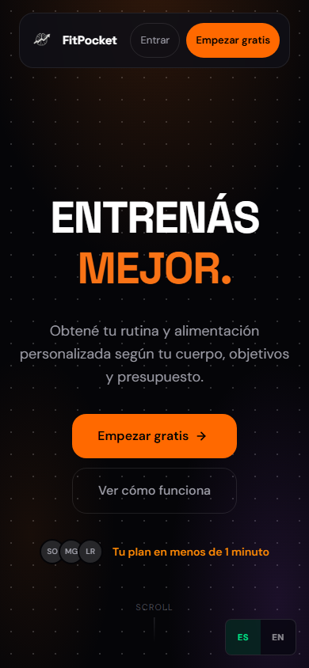

### 1.2 Registrarte

1. Tocá **Empezar gratis**.
2. Escribí tu nombre, tu email y una contraseña de **8 caracteres o más**. Abajo de la contraseña ves si es débil o fuerte: conviene mezclar mayúsculas, números y símbolos.
3. Tocá **Crear cuenta y continuar**. Entrás directo al primer paso para armar tu plan.

Si el email ya está registrado, la app te avisa: en ese caso tocá **Iniciá sesión**.

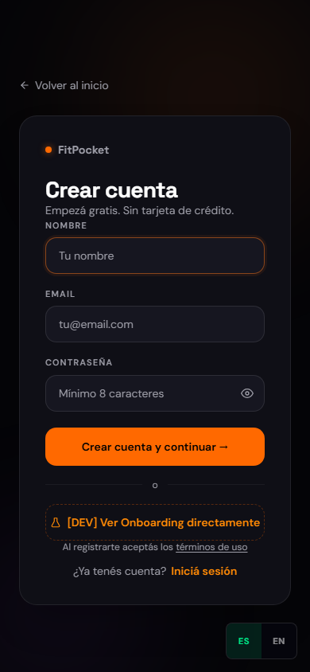

### 1.3 Si te olvidaste la contraseña

1. Tocá **Entrar** y después **¿Olvidaste tu contraseña?**
2. Escribí el email de tu cuenta y tocá **Enviarme el enlace**.
3. Abrí el mail de FitPocket (si no lo ves, revisá el correo no deseado) y tocá el enlace.
4. Escribí tu contraseña nueva dos veces y tocá **Guardar y entrar**.

El enlace **vence en 30 minutos y sirve una sola vez**. Al cambiar la contraseña se cierra tu sesión en los demás dispositivos.

| Pedir el enlace | Elegir la contraseña nueva |
|---|---|
| 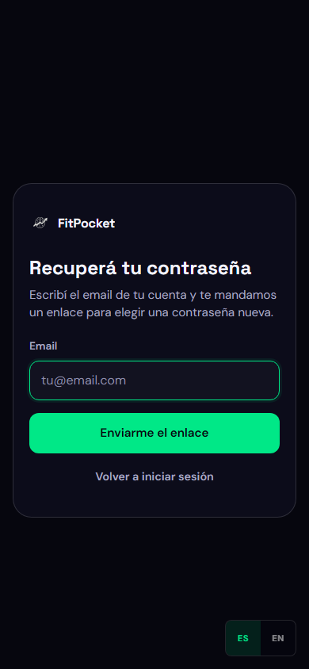 | 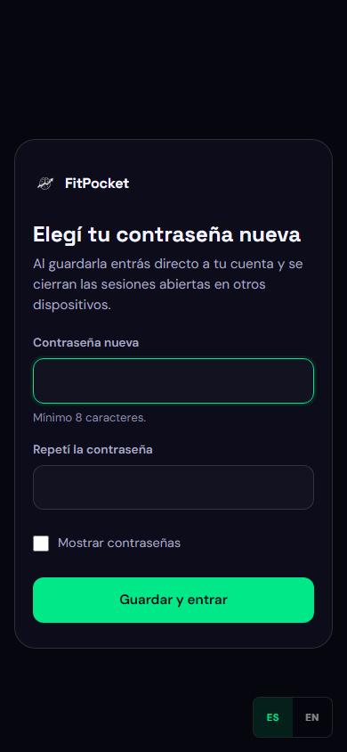 |

La segunda captura muestra lo que ves si el enlace ya venció o ya se usó: tocá **Pedir un enlace nuevo**.

### 1.4 Ayuda

La página de **Ayuda** responde las dudas más comunes. Se abre desde el link "Ayuda" al pie de la página de inicio, o desde el ícono **?** de arriba a la derecha cuando ya tenés sesión. Tocá una pregunta para ver la respuesta.

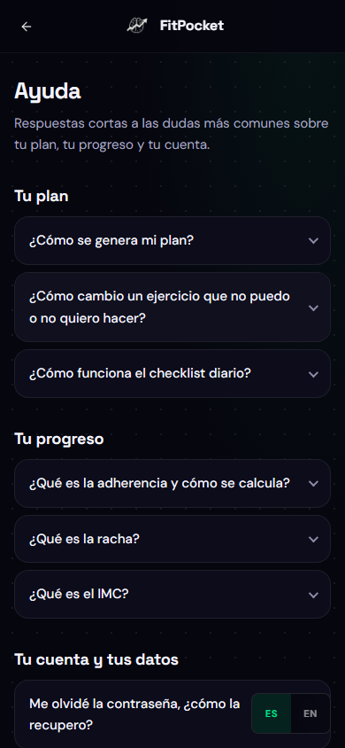

---

## 2. Si ya tenés cuenta

### 2.1 Armar tu plan (onboarding)

La primera vez, la app te hace preguntas en 4 pasos. Si volvés a un paso anterior, lo que cargaste se conserva.

1. **Datos físicos:** edad, peso, altura y sexo. Abajo ves tu IMC calculado en el momento.
2. **Objetivo y nivel:** qué querés lograr (perder grasa, ganar músculo, resistencia, salud general) y tu experiencia entrenando.
3. **Tu rutina:** qué días podés entrenar, cuántos minutos por sesión, tu tipo de alimentación y tu presupuesto mensual (opcional).
4. **Limitaciones:** si tenés alguna limitación física (lumbar, rodilla, hombro, asma, hipertensión) y un espacio para aclarar lo que necesites.

| Paso 1 | Paso 4 |
|---|---|
| 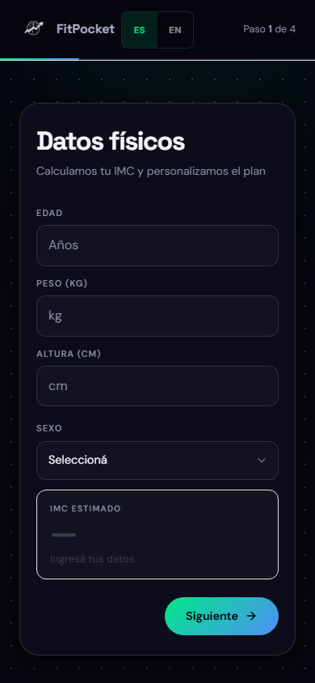 | 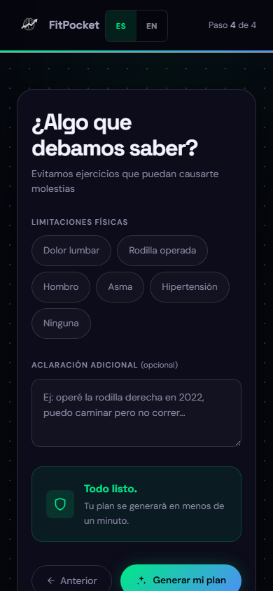 |

Al terminar, la app genera tu plan con inteligencia artificial. **Tarda entre unos segundos y un par de minutos**: dejá la pantalla abierta. Si algo falla, aparece el botón **Reintentar**.

Tus limitaciones y tu aclaración son datos de salud: se guardan **encriptados**.


*(captura pendiente: esta pantalla solo aparece mientras se genera un plan real)*

### 2.2 Tu inicio (dashboard)

Es la pantalla principal. Arriba ves:

- **Racha:** cuántos días seguidos, hasta hoy, registraste el checklist.
- **kcal hoy:** las calorías objetivo de tu dieta.
- **IMC:** tu índice de masa corporal.
- **Adherencia:** qué tanto cumpliste tu plan en los últimos 7 días.

Más abajo: si hoy entrenás o descansás, la semana, y la dieta del día.

Si la adherencia de la semana baja del 50%, aparece un aviso. No es un reto: es para que retomes.

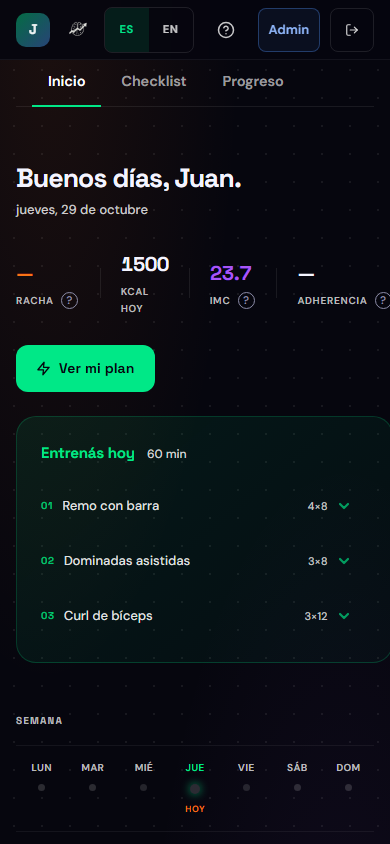

### 2.3 Las ayudas "?"

Al lado de la racha, el IMC, la adherencia, el checklist y otros datos hay un **?**. Tocalo (o llegá con Tab y apretá Enter) para ver una explicación corta; **Más en Ayuda** te lleva a la respuesta completa. Se cierra tocando afuera o con Escape.

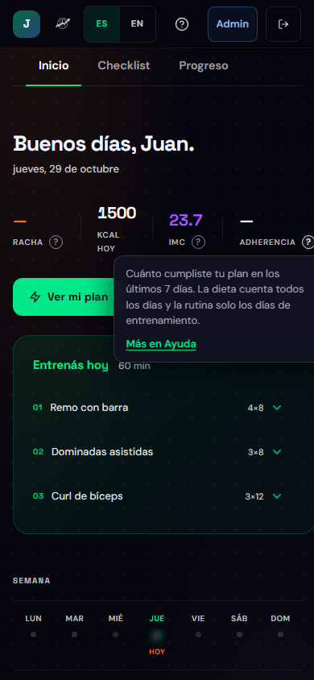

### 2.4 Ver tu plan

Tocá **Ver mi plan**. Elegí un día de la semana arriba: ves la rutina (o el descanso) y la dieta de ese día. Tocá un ejercicio para ver las series, el descanso, los músculos y una nota.

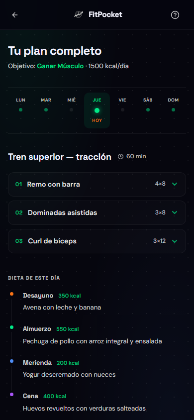

### 2.5 Cambiar un ejercicio

Si un ejercicio no te sale o no tenés el equipo, abrilo y tocá **Cambiar ejercicio**: aparece una alternativa que sugirió la IA. Cada toque muestra la siguiente opción y después vuelve al original.

**El cambio no se guarda**: la próxima vez que abras el plan vas a ver el ejercicio original.

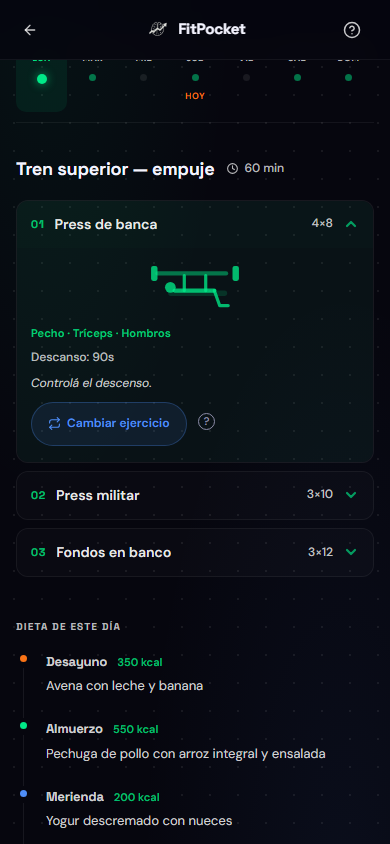

### 2.6 Completar el checklist del día

1. En el inicio, abrí la pestaña **Checklist**.
2. Para la **rutina** y para la **dieta**, elegí cómo te fue: **Completado** (1 punto), **Parcial** (medio punto) o **No hice** (0).
3. Tocá **Guardar día**.

Se registra una vez por día: después de guardar queda fijo hasta mañana. La adherencia y la racha se actualizan al instante.

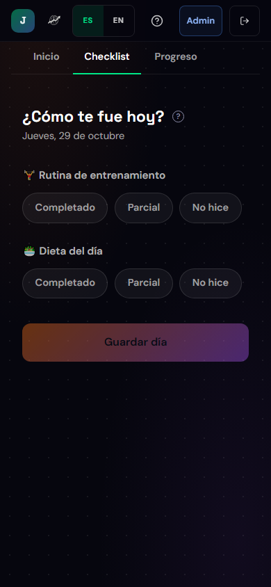

### 2.7 Ver tu progreso

La pestaña **Progreso** muestra una barra por cada día de la semana con cuánto cumpliste, y el peso que cargaste en el onboarding.

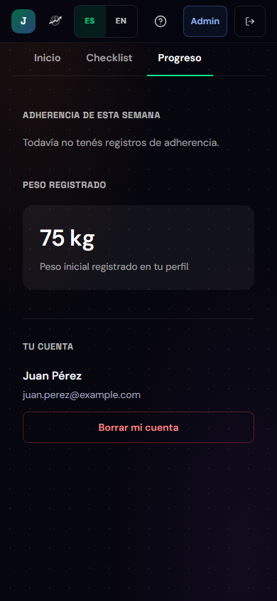

### 2.8 Cambiar el idioma

Tocá **ES** o **EN**. Toda la app cambia en el momento y la próxima vez se abre en el idioma que elegiste. Tu plan queda en el idioma en que se generó.

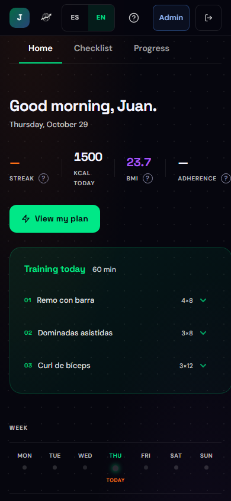

### 2.9 Borrar tu cuenta

1. En el inicio, abrí la pestaña **Progreso** y bajá hasta **Tu cuenta**.
2. Tocá **Borrar mi cuenta**.
3. Leé el aviso y tocá **Sí, borrar mi cuenta**. Para arrepentirte, tocá **Cancelar** o apretá Escape.

Se borran tu cuenta, todos tus planes y todos tus registros. **No se puede deshacer.** Si sos administrador no vas a ver el botón: le tenés que pedir a otro administrador que lo haga.

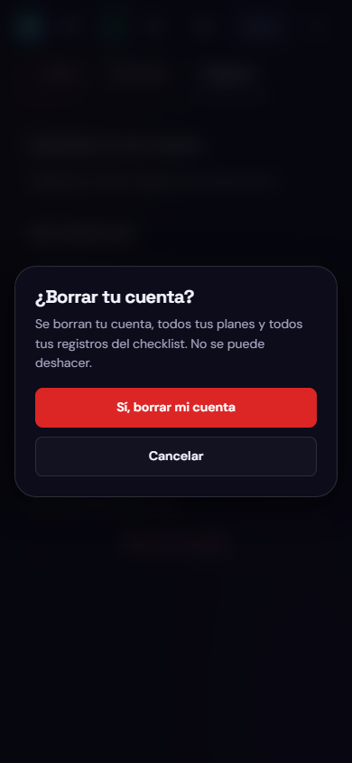

### 2.10 Cerrar sesión

Tocá **Salir** (arriba a la derecha). Si no, la sesión dura 7 días.

---

## 3. Si sos administrador

Entrá al panel con el botón **Admin** del inicio. Ves solo las pestañas para las que tenés permiso. En el celular, la fila de pestañas se desliza de costado.

> **Para el primer administrador:** no hay un botón para "hacerse admin". Alguien con acceso al servidor corre `node scripts/crearAdmin.js email@ejemplo.com` desde `fullStack/backend`. Después, ese administrador puede dar permisos a otros desde el panel.

### 3.1 Usuarios

La lista de todas las cuentas, con rol, fecha de alta y si completaron el onboarding.

- **Buscar:** escribí parte del nombre o del email.
- **Borrar una cuenta:** tocá **Borrar** en su fila y confirmá. Se borran también sus planes y checkins.

Los administradores no tienen botón Borrar: un administrador no puede borrar a otro ni a sí mismo. Si una cuenta dice "Nombre no disponible", se creó con otra clave de cifrado; igual se puede identificar por el email y borrar.

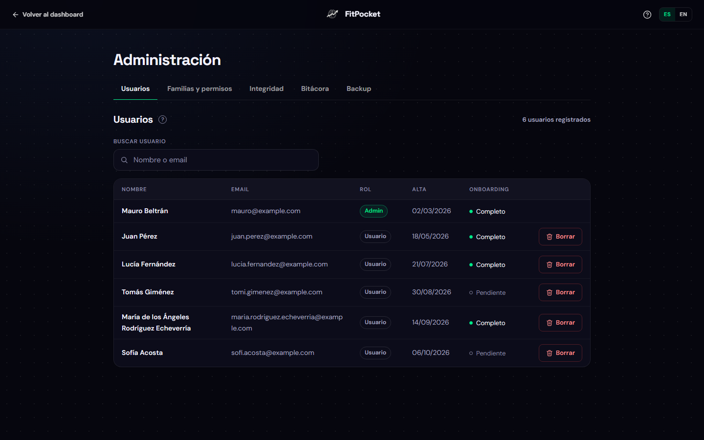

### 3.2 Familias y permisos

Cada acción de la app necesita un **permiso** (una "patente", por ejemplo `usuarios.borrar`). Los permisos se agrupan en **familias**; una familia puede incluir otras. Lo que puede hacer cada persona es la suma de sus familias y de sus permisos sueltos.

**Crear o editar una familia**

1. Tocá **Nueva familia** (o **Editar** en una existente).
2. Poné un nombre y una descripción, marcá las patentes y, si querés, las familias que incluye.
3. Tocá **Guardar familia**.

Las familias **Usuario** y **Administrador** son las base: se pueden editar pero no renombrar. Al editar, la app no te ofrece las familias que formarían un círculo (por ejemplo, meter Administrador dentro de Usuario).

**Dar o quitar permisos a una persona**

1. En **Permisos de un usuario**, elegí la cuenta.
2. Marcá o desmarcá sus familias y sus patentes sueltas. Abajo ves en vivo cuántos permisos va a tener.
3. Tocá **Guardar permisos**.

**El cambio rige en el momento**: la persona no necesita volver a entrar. No podés cambiar tus propios permisos (para no quitarte el acceso por error).

Ejemplo: para que alguien pueda revisar la bitácora y la integridad sin poder borrar nada, creá la familia "Auditor" con `bitacora.ver` e `integridad.verificar` y asignásela.

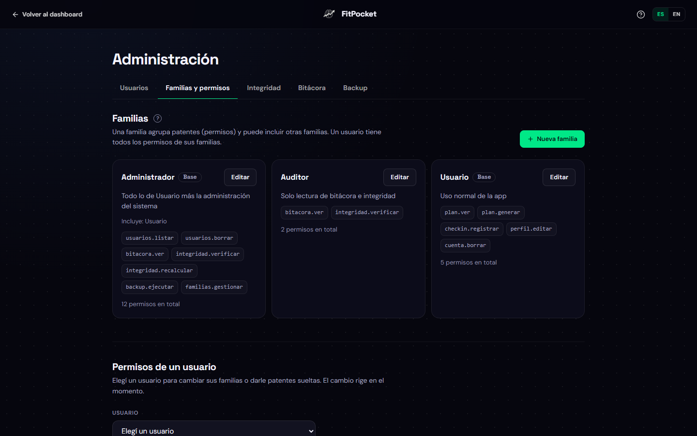

### 3.3 Integridad

Cada registro guarda un **dígito verificador** calculado con sus datos. Si alguien cambia, agrega o borra datos directamente en la base (por fuera de la app), los dígitos dejan de coincidir.

1. Tocá **Verificar**.
2. Vas a ver un resumen, una tabla por colección (usuarios, planes, check-ins) y, si hay problemas, la lista de registros alterados con su email o su fecha.

Si aparecen registros alterados, **primero averiguá qué pasó** (por ejemplo, en la Bitácora). **Recalcular** acepta los datos actuales como válidos: usalo solo después de revisar, o después de una migración o de restaurar un backup. Pide confirmación.

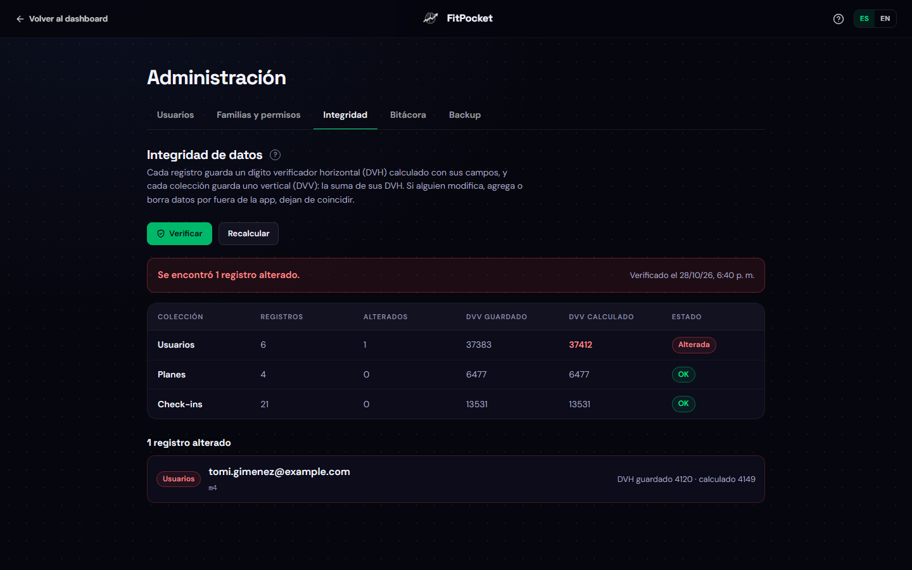

### 3.4 Bitácora

El registro de todo lo que pasa en la app: cada pedido (por ejemplo "Inicio de sesión") y los eventos importantes (plan generado, checkin registrado, usuario borrado). **No guarda contraseñas ni emails.**

1. Filtrá por usuario (email o parte), acción, rango de fechas y resultado (**Correctos**, **Rechazados** o **Errores del servidor**).
2. Tocá **Filtrar**. Con **Anterior** y **Siguiente** pasás de página.

Los registros de más de 180 días se borran solos.

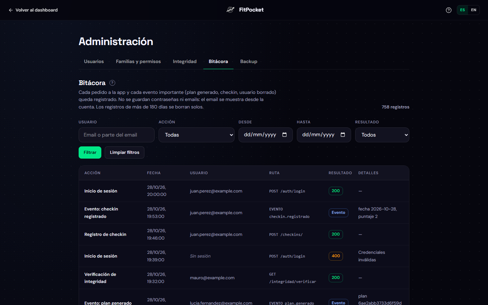

### 3.5 Backup

- **Generar backup:** guarda una copia de toda la base en el servidor. Se conservan los últimos 7.
- **Restaurar:** no se hace desde la web, porque reemplaza todos los datos. Alguien con acceso al servidor corre, desde `fullStack/backend`:
  ```bash
  node scripts/restore.js                     # el último backup
  node scripts/restore.js backup_AAAA-MM-DD_HH-MM-SS
  ```
  Pide confirmación y al terminar recalcula los dígitos verificadores.

Si la app está publicada en Render (plan gratis), los backups del botón se pierden en cada despliegue: en ese caso los backups se hacen por consola desde una computadora del equipo (ver [despliegue](despliegue.md#7-backups-en-producción)).

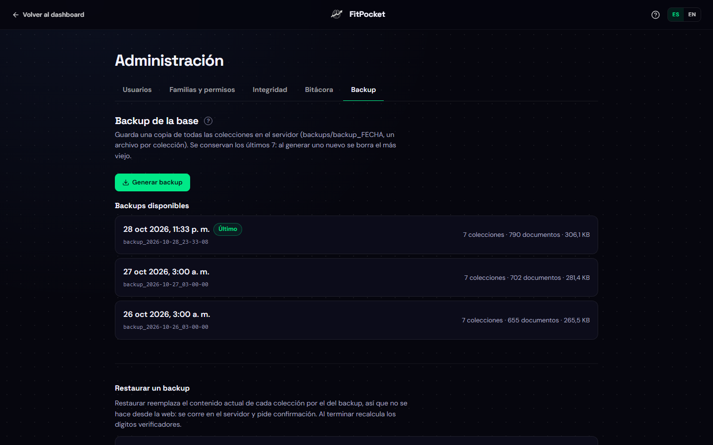

---

## 4. Preguntas frecuentes

Están en la página de **Ayuda** de la app, en español y en inglés:

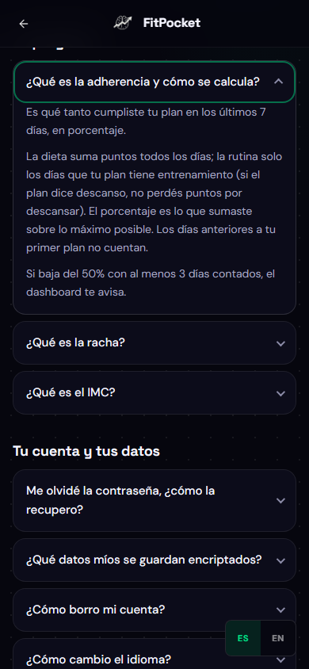

| Pregunta | Respuesta corta |
|---|---|
| ¿Cómo se calcula la adherencia? | Puntos que sumaste en los últimos 7 días sobre los posibles. La dieta cuenta todos los días; la rutina solo los días de entrenamiento |
| ¿Por qué mi racha está en 0? | Se cuenta desde hoy: si todavía no guardaste el checklist de hoy, marca 0 hasta que lo hagas |
| ¿Puedo cambiar lo que registré hoy? | No: el checklist se guarda una vez por día |
| ¿Puedo generar un plan nuevo? | Por ahora, solo al completar el onboarding. Regenerarlo desde el plan está planificado |
| ¿Qué datos míos están encriptados? | Tu nombre, tus limitaciones y tu aclaración. La contraseña ni siquiera se guarda: solo un código que sirve para comprobarla |
| La app tarda mucho en abrir la primera vez | Si está publicada en un servidor gratuito, se "duerme" después de 15 minutos sin uso y tarda hasta un minuto en despertar |
